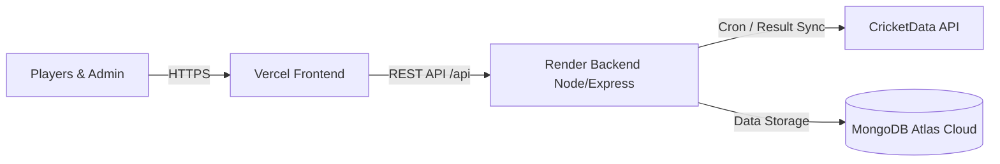

# 🚀 Deployment Guide: Cricket Prediction Game

This guide provides step-by-step instructions for deploying the **Cricket Prediction Game** using the 100% free cloud stack:
- **Database**: [MongoDB Atlas](https://www.mongodb.com/cloud/atlas) (Free M0 Cluster)
- **Backend API**: [Render.com](https://render.com) (Free Web Service)
- **Frontend Web App**: [Vercel](https://vercel.com) (Free Edge Hosting)

---

## Architecture Overview



---

## Step 1: Push Code to GitHub

Both Render and Vercel automatically deploy from your GitHub repository.

1. Open PowerShell or Terminal in the project root:
   ```bash
   git init
   git add .
   git commit -m "Initial commit for production deployment"
   ```

2. Create a new repository on [GitHub](https://github.com/new) (e.g. `cricket-prediction-game`).
3. Link and push your code:
   ```bash
   git branch -M main
   git remote add origin https://github.com/<your-username>/cricket-prediction-game.git
   git push -u origin main
   ```

---

## Step 2: Set Up MongoDB Atlas (Free Cloud Database)

1. Go to [MongoDB Atlas](https://www.mongodb.com/cloud/atlas) and sign up / log in.
2. Click **Create a Deployment** and select the **M0 Free** shared cluster.
3. Choose a cloud provider and region closest to your players (e.g. AWS / Mumbai or Frankfurt).
4. **Create a Database User**:
   - Username: e.g. `cricket_admin`
   - Password: Create a strong password (save this!).
5. **Configure Network Access**:
   - Go to **Network Access** in the left sidebar.
   - Click **Add IP Address** -> Select **Allow Access from Anywhere** (`0.0.0.0/0`) -> Confirm.
   *(This allows Render's cloud servers to connect to your database).*
6. **Get Your Connection String**:
   - Click **Database** -> **Connect** -> Choose **Drivers** (Node.js).
   - Copy the connection string:
     ```
     mongodb+srv://cricket_admin:<password>@cluster0.xxxxx.mongodb.net/cricket_prediction_game?retryWrites=true&w=majority
     ```
   - Replace `<password>` with your database user password.

---

## Step 3: Deploy Backend on Render.com

1. Go to [Render.com](https://render.com) and log in with GitHub.
2. Click **New +** -> **Web Service**.
3. Select your GitHub repository (`cricket-prediction-game`).
4. Configure the settings:
   - **Name**: `cricket-prediction-api` (or your choice)
   - **Region**: Choose closest to your MongoDB region (e.g. Singapore or Frankfurt)
   - **Root Directory**: `server`
   - **Runtime**: `Node`
   - **Build Command**: `npm install`
   - **Start Command**: `node src/server.js`
   - **Instance Type**: `Free`
5. Click **Advanced** -> **Add Environment Variable** and add the following:

   | Key | Value | Description |
   | :--- | :--- | :--- |
   | `NODE_ENV` | `production` | Production mode |
   | `PORT` | `5000` | Express port |
   | `MONGO_URI` | `mongodb+srv://...` | Connection string from Step 2 |
   | `JWT_SECRET` | *(Random 32+ char secret)* | Generates secure login tokens |
   | `ADMIN_EMAIL` | `admin@cricket.local` | Email to log in as league admin |
   | `ADMIN_PASSWORD` | *(Your secure password)* | Admin password |
   | `ADMIN_NAME` | `Admin` | Admin display name |
   | `CRICKET_API_KEY` | `20f0783f-fe24-4444-a79d-9e0e42405f5f` | CricketData API key |
   | `CRICKET_API_BASE_URL` | `https://api.cricapi.com/v1` | CricketData endpoint |
   | `RESULT_SYNC_CRON` | `*/10 * * * *` | Auto-sync results every 10 mins |
   | `CLIENT_URL` | `http://localhost:5173` | *(Temporary; update in Step 5)* |

6. Click **Deploy Web Service**.
7. Once deployed, Render will provide your Backend URL:
   `https://cricket-prediction-api-xxxx.onrender.com`
   *(Test it in your browser at `https://cricket-prediction-api-xxxx.onrender.com/api/health`)*.

---

## Step 4: Deploy Frontend on Vercel

1. Go to [Vercel](https://vercel.com) and log in with GitHub.
2. Click **Add New...** -> **Project**.
3. Import your `cricket-prediction-game` repository.
4. Configure Project Settings:
   - **Framework Preset**: `Vite`
   - **Root Directory**: Click *Edit* and select `client`
   - **Build Command**: `npm run build` (default)
   - **Output Directory**: `dist` (default)
5. Under **Environment Variables**, add:

   | Key | Value |
   | :--- | :--- |
   | `VITE_API_URL` | `https://cricket-prediction-api-xxxx.onrender.com/api` |

   *(Make sure to use your actual Render backend URL from Step 3 with `/api` at the end)*.
6. Click **Deploy**.
7. Vercel will build and deploy your app, providing your live Frontend URL:
   `https://cricket-prediction-game.vercel.app`

---

## Step 5: Connect Frontend to Backend (Final Link)

1. Go back to your [Render.com Dashboard](https://dashboard.render.com).
2. Open your backend service -> **Environment**.
3. Update `CLIENT_URL` to match your live Vercel URL:
   ```
   CLIENT_URL=https://cricket-prediction-game.vercel.app
   ```
4. Click **Save Changes**. Render will automatically restart with the new CORS setting.

---

## 🎉 Verification & First-Time Admin Login

1. Open your live Vercel URL in your browser: `https://cricket-prediction-game.vercel.app`.
2. Click **Login** and enter your Admin credentials from Render:
   - **Email**: `admin@cricket.local` (or your configured `ADMIN_EMAIL`)
   - **Password**: Your configured `ADMIN_PASSWORD`
3. You will enter the **Admin Control Panel**:
   - Live fixtures will load automatically.
   - Click any quick-pick chip (e.g. `India`, `Australia`, `IPL`, `CSK`) or search for any team.
   - Select a match, configure Win/Loss points, and click **Publish Contest Now**.
4. Share your Vercel link with friends!
   - Friends register their accounts.
   - You approve them under **Pending users**.
   - They predict winners and compete on the leaderboard!

---

> [!TIP]
> **Render Free Tier Spin-Down**:
> On Render's free tier, the backend web service spins down after 15 minutes of inactivity. When someone visits the site after a pause, the first request may take 30–50 seconds while the server spins back up. Once awake, it responds in milliseconds.
